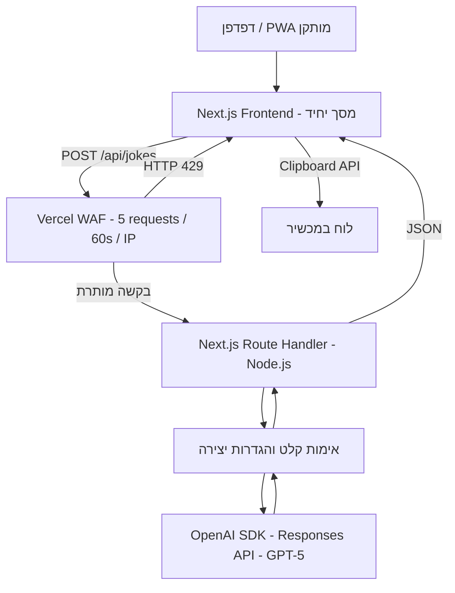

# ARCHITECTURE — מחולל בדיחות מבוסס AI

> **בסיס:** `PRD.md` — מחולל בדיחות מבוסס AI  
> **מועד בדיקת המקורות:** 21 באוקטובר 2026  
> **מטרה:** תכנון טכני ישים למימוש דרישות המוצר, ללא הוספת יכולות מוצר שאינן ב־PRD.

## 1. Technology Stack שנבחר

| רכיב | בחירה | תפקיד |
| --- | --- | --- |
| Frontend | **React + Next.js App Router** | מסך יחיד מותאם למובייל, ניהול מצב התצוגה ופניות ל־Backend |
| שפת פיתוח | **TypeScript** | טיפוסים משותפים ל־Frontend ול־Backend, תחזוקה ואימות מבנה נתונים |
| Backend | **Next.js Route Handlers, Node.js runtime** | `POST /api/jokes`, אימות קלט, הפעלת GPT-5, טיפול בתקלות |
| שירות AI | **OpenAI GPT-5** דרך **Responses API** וה־SDK הרשמי `openai` | יצירת בדיחה בנושא שנבחר |
| Hosting ו־Deployment | **Vercel** | אירוח Frontend ו־Serverless Backend באותו פרויקט ופריסה מתוך GitHub |
| Rate Limiting | **Vercel WAF Rate Limiting** | אכיפת חמש פניות בדקה לפי כתובת IP ללא Database |
| PWA | **Web App Manifest**, אייקונים ו־HTTPS | תמיכה בהוספה למסך הבית והפעלה במצב `standalone` במכשירים תומכים |
| Version Control | **Git + GitHub** | Repository מרכזי; פיתוח בענף `dev` ו־`main` ל־Production (ADR-1) |
| Database / Object Storage | **אין** | אין היסטוריה, חשבונות או קבצים דינמיים לשמירה |
| Authentication / Authorization | **אין** | שימוש אנונימי וחופשי; הגנת Endpoint באמצעות אימות קלט ו־WAF |
| CSS | **CSS Modules / CSS רגיל** | סגנון ממשק ללא ספריית עיצוב נוספת, לפי `DESIGN.md`; גופנים נטענים דרך `next/font` |
| בדיקות | **Vitest** | בדיקות אוטומטיות קלות ל־`/api/jokes` ולשירות היצירה, עם OpenAI מדומה (ראו 2.10) |
| Runtime | **Node.js 22.x** | מוגדר ב־`engines` של `package.json` כדי ש־Vercel והפיתוח המקומי ירוצו על אותה גרסה |

### נימוקי הבחירה והחלופות שנבחנו

- **Frontend ו־Backend:** Next.js נבחר על פני שילוב Vite/React עם Backend עצמאי ועל פני SvelteKit. הוא פתרון Mainstream בעל תיעוד נרחב, מאפשר Route Handlers מובנים, ומצמצם את מספר פרויקטי הפריסה והתשתיות. עבור מסך יחיד הוא אינו הפתרון הקל ביותר מבחינת משקל Framework, אך איחוד ה־Frontend וה־Backend מפשט את הפרויקט הכולל. אין צורך ב־Express או NestJS נפרדים.
- **Hosting:** Vercel נבחר על פני Render ו־Cloudflare Workers בזכות אינטגרציית Next.js, התמיכה ב־Node.js, חיבור ישיר ל־GitHub ו־WAF Rate Limiting מובנה. GitHub Pages אינו מתאים לבדו, משום שהוא אינו מספק את ה־Backend המאובטח הנדרש ל־OpenAI API.
- **Rate Limiting:** Vercel WAF נבחר על פני Upstash Redis ורישום מונים בזיכרון של Function. הוא מאפשר אכיפה בנקודת הכניסה, ללא שירות State נוסף. מונה בזיכרון של Serverless Function אינו עקבי בין מופעים. פתרון Upstash היה מאפשר מפתחות זיהוי מותאמים יותר, אך מוסיף תשתית שאינה דרושה לדרישות הנוכחיות.
- **AI:** נבחנו שירותי AI חלופיים מבחינת התאמה כללית, אך **GPT-5 הוא דרישה מחייבת ב־PRD**, ולכן נבחר API הרשמי של OpenAI. יש להשתמש במזהה המודל `gpt-5` ולא להחליפו אוטומטית במודל חדש או זול יותר.
- **PWA:** היכולות המובנות של Next.js ל־Web App Manifest נבחרו על פני חבילות PWA עם caching מתקדם, משום שלא נדרשת עבודה ב־Offline. אין להוסיף cache לבקשות בדיחות או תשתית push notifications.
- **Database ו־Authentication:** לא יותקנו Supabase, Prisma, NextAuth/Auth.js, Redis או שירות אחסון. התוספת לא תורמת לדרישות ומנוגדת לעקרון הפשטות; בפרט, אין צורך בהפרדת פרויקטי Supabase או ב־Database Migrations.

### סיכונים ופשרות ידועים

1. **משתמש אנונימי אינו מזוהה באופן ודאי:** WAF יחשב בקשות לפי IP, ולא לפי אדם. משתמשים מאותו IP ציבורי (לדוגמה רשת משרדית) חולקים מכסה; משתמש שמחליף IP עשוי לקבל מכסה נוספת. אין להציג מגבלה זו כהגנה מושלמת מפני שימוש לרעה.
2. **מגבלת חמש בדיחות בדקה:** מיושמת כ־**חמש בקשות HTTP חדשות ל־`/api/jokes` בחלון Fixed Window של 60 שניות לכל IP**, ולא כמגבלה יומית או כספירת בקשות פנימיות ל־OpenAI. חלון קבוע מאפשר פרצי בקשות סמוך לגבול החלון; אין הבטחת Rolling Window. הניסיון החוזר ל־OpenAI נעשה בתוך אותה בקשת HTTP ואינו צורך מכסת WAF נוספת.
3. **תגובות WAF:** כאשר הסף נחצה, WAF מחזיר HTTP `429` לפני שה־Route Handler פועל. לפיכך ההודעה בעברית נוצרת בצד הלקוח בעת קבלת `429`, גם אם גוף התשובה מ־WAF אינו בפורמט JSON של האפליקציה.
4. **התקנת PWA משתנה לפי מכשיר ודפדפן:** יש לספק manifest, icons ו־HTTPS, אך לא להבטיח הופעת Install Prompt בכל דפדפן. אין תמיכה ב־Offline. אין להוסיף Service Worker לצורך caching; אם תנאי התקנה בפלטפורמת יעד מסוימת מחייבים Service Worker, יש לספק handler מינימלי ללא cache של ממשק או API וללא התנהגות Offline.
5. **הוצאות:** גישה ציבורית חופשית עלולה ליצור עלויות API גם עם הגבלה לכל IP. יש להגדיר התראות ומגבלות הוצאה בחשבון OpenAI, ולבדוק חיוב Vercel. תוכנית Vercel Hobby מיועדת לפרויקטים אישיים לא־מסחריים; שימוש מסחרי מחייב תוכנית המתאימה לתנאי השירות.
6. **משך תגובה:** זמני GPT-5 עשויים להשתנות. שתי פניות עוקבות (בכישלון) עשויות לייקר את הבקשה ולהאריך את ההמתנה. כדי לעמוד ביעד "בדיחה במהירות" מוגדרים רמת חשיבה נמוכה ו־Timeouts קצרים (ראו 2.5), ולא יישמר מצב ב־Function לאחר סיום התשובה.
7. **זמינות המודל:** ה־PRD מחייב GPT-5. אם המזהה `gpt-5` אינו זמין או הוכרז כמיועד להסרה בעת הבנייה — יש לעצור ולשאול, ולא להחליף מודל באופן עצמאי.

## 2. ארכיטקטורת המערכת

### 2.1 מבנה המערכת ואחריות הרכיבים



- **Client:** מציג את תיבת הנושא, כפתור `צור בדיחה`, בדיחה אחת ותחתיה הכפתורים `בדיחה נוספת` ו־`העתק בדיחה`; מטפל בטעינה, בהודעות שגיאה ובהעתקה.
- **WAF:** מגביל בקשות נכנסות לנתיב היצירה לפני התשלום על שימוש במודל.
- **Route Handler:** מאמת JSON ונושא, מכין הוראות מודל, מבצע קריאה ל־GPT-5 עם ניסיון חוזר אחד על כישלון בר־חזרה, מחזיר תוצאה מסוננת כטקסט או קוד שגיאה.
- **OpenAI API:** מחולל את טקסט הבדיחה. לא מתבצע חיבור ישיר בין הדפדפן ל־OpenAI.
- **Vercel:** מארח Assets סטטיים ואת ה־Route Handler, מספק HTTPS ותהליכי Preview/Production.

### 2.2 חלוקה ל־Modules לוגיים

| שכבה / Module | אחריות |
| --- | --- |
| `Joke UI` | קלט, כפתורים, בדיחה מוצגת, חיווי טעינה, הצגת שגיאות בעברית |
| `Client Joke State` | `draftTopic`, `displayedJoke`, `lastSuccessfulTopic`, `requestStatus`; נשמרים בזיכרון בלבד |
| `Joke API Client` | שליחת `POST` ב־same-origin, פירוש Status Codes ו־JSON |
| `Joke Route` | בקרת Method, Content-Type, Body Size ואורך הנושא; הפעלת שירות יצירה |
| `Joke Generation Service` | בניית הנחיות ל־GPT-5, מדיניות Retry/Timeout, אימות תגובת המודל |
| `OpenAI Adapter` | קריאה ל־Responses API עם Secret בסביבת שרת בלבד |
| `Vercel WAF Policy` | Rate Limit עצמאי של הנתיב `/api/jokes` לפי IP |
| `PWA Metadata` | Manifest, אייקונים ומידע להתקנה |

אין צורך ב־State Management library, מערכת Events, Queue, Cron, WebSocket, ORM או שירותי Microservices.

### 2.3 Data Model ושמירת מידע

אין Database, Object Storage, `localStorage`, `sessionStorage` או היסטוריית בדיחות. מידע המשמש את ה־UI חי בזיכרון של העמוד הנוכחי:

| שדה | טיפוס | משמעות |
| --- | --- | --- |
| `draftTopic` | `string` | הטקסט הנוכחי בתיבה, עד 100 תווים |
| `displayedJoke` | `string \| null` | הבדיחה היחידה המוצגת |
| `lastSuccessfulTopic` | `string \| null` | הנושא שבו נוצרה בהצלחה הבדיחה המוצגת; מחרוזת ריקה מייצגת בדיחה כללית |
| `requestStatus` | `idle \| loading \| error` | מצב בקשת היצירה |
| `errorCode` | `string \| null` | מזהה שגיאה לוגי לצורך הצגת הודעה בעברית |

**כללי מצב:**
- `צור בדיחה` משתמש בערך הנוכחי של `draftTopic`, לאחר הסרת רווחים בקצוות; נושא שכל כולו רווחים מטופל כריק. אין לשנות את `displayedJoke` או `lastSuccessfulTopic` עם תחילת הבקשה.
- `בדיחה נוספת` משתמש בערך `lastSuccessfulTopic`, גם אם `draftTopic` השתנה. הכפתור זמין רק לאחר הצלחת יצירה ראשונה.
- הצלחה מחליפה את הבדיחה ומעדכנת `lastSuccessfulTopic` לאותו נושא ששימש בבקשה שהצליחה.
- שגיאה משאירה את הבדיחה הקודמת, אם קיימת. רענון העמוד מאפס את כל המצבים.
- בעת בקשה פעילה כפתורי היצירה מושבתים כדי למנוע כפילות; ההעתקה מתייחסת לבדיחה שכרגע מוצגת.
- כדי למנוע תוצאה ישנה שדורסת חדשה, יש לאפשר בקשת יצירה אחת פעילה בכל זמן; ניתן לבטל בקשת דפדפן בביטול ניווט. ביטול בצד הלקוח אינו מבטיח ביטול חיוב עבור בקשת API שכבר נשלחה.
- אין שמירה מקומית של בדיחות דרך PWA cache. לוגים תשתיתיים ונתוני שימוש בספקי שירות עשויים להישמר לפי מדיניותם ואינם "היסטוריה" מנוהלת על ידי האפליקציה.

### 2.4 ממשק API

**Endpoint יחיד:** `POST /api/jokes` ב־HTTPS, תחת אותו Origin של האתר.

**Request:**

```json
{"topic":"חתולים","previousJoke":"למה החתול ישב ליד המחשב? כי הוא חיפש את העכבר!"}
```

`topic` הוא `string` אופציונלי, עד 100 תווים. מותר `""` או היעדר שדה ליצירת בדיחה כללית. `previousJoke` הוא `string` אופציונלי עד 1,000 תווים, שנשלח רק מכפתור `בדיחה נוספת` כדי שהמודל לא יחזור על הבדיחה המוצגת (FR-03); הוא משמש כנתון בלבד ואינו נשמר. JSON פגום, טיפוסים שאינם `string` ושדות ארוכים מהמותר נדחים. יש להגביל גם את גודל גוף הבקשה ברמת ה־Backend ל־**4KB** להגנה מפני קלטים חריגים (עברית תופסת כ־2 בתים לתו); זהו סף תפעולי ולא מגבלת מוצר נוספת.

**ספירת תווים:** אורך נמדד כ־`Array.from(value.trim()).length`, באותה פונקציה משותפת בממשק וב־Backend, כך שאמוג'י נספר כתו אחד בשני הצדדים. בממשק האכיפה נעשית בקוד (ב־`onChange`) ולא רק בתכונה `maxLength`, שסופרת אחרת.

**Success — HTTP 200:**

```json
{"joke":"למה החתול ישב ליד המחשב? כי הוא חיפש את העכבר!"}
```

**Errors — מבנה JSON אחיד, כאשר הבקשה מגיעה ל־Backend:**

```json
{"error":{"code":"AI_UNAVAILABLE"}}
```

| HTTP | קוד לוגי | התנהגות |
| --- | --- | --- |
| `400` | `INVALID_INPUT` | קלט לא תקין, נושא מעל 100 תווים או `previousJoke` מעל 1,000 תווים |
| `413` | `PAYLOAD_TOO_LARGE` | גוף בקשה גדול מהמגבלה |
| `422` | `TOPIC_REFUSED` | המודל סירב לנושא לפי מדיניות התוכן (PRD FR-02); ללא Retry |
| `429` | `RATE_LIMITED` | ה־WAF חוסם; הלקוח מפרש קוד HTTP גם ללא JSON |
| `502` | `AI_UNAVAILABLE` | שירות AI לא השלים יצירה לאחר ניסיון חוזר אחד, או החזיר תוכן בלתי שמיש |
| `503` | `SERVICE_UNAVAILABLE` | תקלת תצורה או זמינות זמנית של השירות |
| `504` | `AI_TIMEOUT` | חלפו מגבלות הזמן שהוגדרו ב־Backend |

ה־Frontend אינו מציג הודעות מערכת גולמיות מה־Backend או מ־OpenAI. הצגת השגיאה תמיד בשפת הממשק — עברית, **לפי טבלת הנוסחים ב־`DESIGN.md`**, שהיא המקור היחיד לטקסטים. אין התחייבות ל־`Retry-After` כשהחסימה מבוצעת ב־WAF; ההודעה כללית.

**Headers והתנהגות HTTP:** `Content-Type: application/json`, `Cache-Control: no-store` לתגובות API; לדרוש POST בלבד, ואין להגדיר CORS פתוח. בדפדפן יש להשתמש ב־`fetch('/api/jokes', ...)`; אין להטמיע מפתחות ב־Request או ב־Frontend bundle.

**Headers אבטחה (Milestone 4, דרך `headers()` ב־`next.config.ts`):** `X-Content-Type-Options: nosniff`, `Referrer-Policy: strict-origin-when-cross-origin`, `X-Frame-Options: DENY`, ו־`Permissions-Policy` שחוסם מצלמה, מיקרופון ומיקום. אין חובה ב־`Content-Security-Policy` מלא בגרסה זו, כי הוא מסבך את Next.js ואינו נדרש לאתר בלי תוכן HTML ממשתמשים.

### 2.5 זרימות המידע

**יצירת בדיחה:**
1. המשתמש מזין נושא או משאיר תיבה ריקה, ולוחץ `צור בדיחה`.
2. Frontend שולח בקשת `POST` אחת ל־`/api/jokes`; מתבצע חיווי טעינה.
3. Vercel WAF סופר את הבקשה לפי IP ומחזיר `429` כשהמכסה נחצתה. בקשה חסומה אינה מגיעה ל־OpenAI.
4. Route Handler בודק את הקלט, מבצע נרמול רווחים לצורך ההנחיות ומכין בקשה ל־GPT-5.
5. ה־Backend שולח ל־OpenAI Responses API קריאה עם ההגדרות שבטבלה למטה: הוראות נפרדות מהקלט, ו־`store: false`. אין מגבלת מספר משפטים במוצר.
6. הוראות המודל: יצירת בדיחה המתייחסת לנושא; סגנון ואורך גמישים; כללי השפה של PRD FR-02 (עברית / אנגלית / שפה אחרת → עברית / מעורב → דומיננטית); מדיניות התוכן של PRD FR-02; טקסט רגיל בלבד, בלי כותרת, מירכאות, Markdown או הסבר, עם שבירות שורה במידת הצורך; אם נשלח `previousJoke` — בדיחה שונה ממנה. אם הנושא אינו מאפשר בדיחה לפי המדיניות גם בזווית קלילה, המודל מחזיר את המחרוזת `[[REFUSED]]` בלבד. הנושא ו־`previousJoke` יטופלו כ־**נתונים**, לא כפקודות להתגבר על הוראות המערכת.
7. עיבוד התשובה: הטקסט עובר `trim`. `[[REFUSED]]` או תוכן מסוג refusal מה־API → `422 TOPIC_REFUSED`. תשובה ריקה או בסטטוס `incomplete` → כשל זמני (ראו ניסיון חוזר). בתגובה תקינה ה־Backend מחזיר את הטקסט בלבד ללא מטא־נתוני ספק, והלקוח מחליף את הבדיחה הקודמת באותו מסך.

**הגדרות המודל (ערכי פתיחה, יש לכייל לפי התנהגות בפועל):**

| הגדרה | ערך | סיבה |
| --- | --- | --- |
| `model` | `gpt-5` | דרישת PRD; לא להחליף באופן עצמאי |
| `reasoning.effort` | `minimal` (או `low` אם האיכות נמוכה מדי) | בדיחה אינה דורשת חשיבה ארוכה; מקצר המתנה ומוזיל |
| `text.verbosity` | `low` | תשובה תמציתית |
| `max_output_tokens` | `1000` | המגבלה כוללת גם טוקני חשיבה; ערך נמוך מדי מחזיר תשובה ריקה |
| `store` | `false` | ללא שמירת שיחה אצל הספק |
| SDK `maxRetries` | `0` | הניסיון החוזר מנוהל בקוד (מ־Milestone 2) |
| SDK `timeout` לניסיון | `15` שניות | יעד: בדיחה תוך כ־10 שניות ברוב המקרים |
8. אין Persist של נתוני בקשה או בדיחה. מצב הדפדפן יאופס ברענון.

**בדיחה נוספת:** לחיצה על `בדיחה נוספת` מפעילה אותו Endpoint עם `lastSuccessfulTopic`, ולא עם `draftTopic` הנוכחי. התוצאה מחליפה את הקודמת רק בהצלחה.

**ניסיון חוזר:** Backend מבצע **לכל היותר שתי קריאות OpenAI עבור בקשת משתמש יחידה** — קריאה ראשונה ועוד ניסיון חוזר אוטומטי אחד על כשל זמני (כגון network failure, timeout, HTTP 429 של OpenAI או שגיאות 5xx). אין לבצע Retry על קלט לא חוקי, שגיאות אימות/הרשאות/תקציב, או 429 מ־Vercel WAF. ה־OpenAI SDK מבצע Retries באופן מובנה: יש להגדיר `maxRetries: 0` **כבר ב־Milestone 2**, כדי שלא ייווצרו ניסיונות נוספים בלי כוונה; הניסיון החוזר המפורש נוסף ב־Milestone 4. Timeout של 15 שניות לכל ניסיון ותקרה כוללת של כ־30 שניות לבקשה. אין Retry על `TOPIC_REFUSED`. ב־Frontend מוגדר `AbortController` עם תקרה של 35 שניות, ולאחריה מוצגת הודעת שגיאה; אין להפעיל Retry אוטומטי נוסף ב־Frontend.

**העתקה:** לחיצה על `העתק בדיחה` מפעילה Browser Clipboard API עם `displayedJoke` הנוכחי, בהקשר HTTPS (או `localhost`). בהצלחה הכפתור מציג `הועתק!` לכשתי שניות; במקרה של כישלון מוצגת הודעה בעברית; אין צורך בפנייה לשרת.

**בדיחה נוספת — תוכן הבקשה:** הלקוח שולח `topic: lastSuccessfulTopic` ו־`previousJoke: displayedJoke`.

### 2.6 אבטחה, פרטיות ותוכן

- כל הפניות ל־OpenAI מתבצעות מ־Route Handler ב־Node.js בלבד. מפתח `OPENAI_API_KEY` נשמר ב־Server-side Environment Variables של Vercel; **לעולם לא** בשם `NEXT_PUBLIC_*`, לא ב־GitHub, לא ב־manifest, לא ב־logs ולא בתגובה למשתמש.
- `topic` הוא קלט משתמש לא מהימן: לאמת טיפוס, אורך ופורמט, ולא להריץ אותו כקוד. להציבו בתוכן הבקשה כנתון ולא כהוראת מערכת. להציג טקסט בדיחה באמצעות React text rendering בלבד, ללא `dangerouslySetInnerHTML`.
- אין Authentication ואין Authorization של משתמשים, בהתאם ל־PRD. Rate Limiting אינו תחליף לחסינות מלאה מפני abuse; ניתן להפעיל הגנות תשתית בסיסיות בלי להוסיף זרימת משתמש חדשה.
- אין לבנות מערך זיהוי/מעקב אישי או להניח שמכסה לפי IP מזהה משתמש מסוים בוודאות.
- ב־Responses API להשתמש ב־`store: false`, ללא thread/conversation state, וללא שמירת prompts או בדיחות ביומני האפליקציה. הגדרה זו אינה מבטלת בהכרח כל עיבוד או שמירה הנובעים ממדיניות ספקי התשתית; יש לעיין בתנאי OpenAI ו־Vercel.
- ניהול תקינות: אין לחשוף stack traces, prompt פנימי, מזהי חשבון או פרטי חשבונית/מפתחות; רישום תפעולי מינימלי של HTTP status, זמן תגובה וקודי שגיאה מבלי לשמור תוכן בדיחות.
- להגדיר בקרות הוצאה והתראות בחשבון OpenAI ולנטר WAF/Vercel, מאחר שהגבלה לכל IP אינה חוסמת תנועה המגיעה מכתובות רבות.
- התכנים נוצרים בידי מודל הסתברותי: אין הבטחה לבדיחה מצחיקה בכל קריאה, לעמידה מושלמת במדיניות התוכן או לזיהוי מושלם של טקסט דו־לשוני. כללי השפה ומדיניות התוכן מוגדרים ב־PRD FR-02; ההוראות למודל מיישמות אותם.

### 2.7 PWA וממשק

- להשתמש ב־Next.js Web App Manifest הכולל `name`/`short_name` ו־`theme_color` כפי שמוגדרים ב־`DESIGN.md`, `start_url: '/'`, `display: 'standalone'`, `lang: 'he'`, `dir: 'rtl'`, ואייקונים בגדלים מתאימים, כולל 192×192, 512×512 ו־`apple-touch-icon` 180×180 לאייפון (מקור האייקון ב־`DESIGN.md`).
- להגדיר `lang="he"` ו־`dir="rtl"` למסמך, ולהבטיח ממשק רספונסיבי למובייל. טקסט הנושא או הבדיחה באנגלית יוצג בכיווניות מתאימה (`dir="auto"`) בלי לשנות את כיוון הממשק כולו.
- אין שימוש ב־Service Worker לניהול קאש Offline, ואין שמירת API responses; התקנה והיקף התמיכה בה תלויים בדרישות הדפדפן והמכשיר.
- טקסט הכפתורים נשאר בעברית כמוגדר ב־PRD: `צור בדיחה`, `בדיחה נוספת`, `העתק בדיחה`. חיווי טעינה והודעות שגיאה בעברית לפי טבלת הנוסחים. העיצוב החזותי מוגדר ב־`DESIGN.md`.
- להציג את תוכן הבדיחה באופן קריא ובעל תמיכה בנגישות מקלדת וב־screen reader. **חובה:** אזור הבדיחה ואזור ההודעות מסומנים `aria-live="polite"`, כך שתוצאה חדשה, טעינה ושגיאה מוקראות בלי מעבר מסך.
- שבירות שורה בבדיחה נשמרות בתצוגה (`white-space: pre-line`).

### 2.8 Hosting, GitHub ו־Deployment

**ניהול Repository**
- Repository יחיד ב־GitHub מכיל Next.js Frontend, Route Handler, manifest, קבצי assets סטטיים ותצורת פריסה.
- ענף `main` הוא מקור ה־Production. **הפיתוח של Milestones 2–4 נעשה בענף קבוע אחד, `dev`**, שכל דחיפה אליו יוצרת Preview Deployment. `dev` ממוזג ל־`main` רק ב־Milestone 5, לאחר אישור המשתמש (ראו ADR-1). אין צורך ב־feature branch לכל שינוי, במספר Repositories או בתהליך CI/CD עצמאי רק לצורך פריסה.
- `.gitignore` כולל `.env` ו־`.env.*`, עם חריגה מפורשת `!.env.example` כדי שקובץ הדוגמה (ללא ערכים) יעלה ל־GitHub. לשמור lockfile; להגדיר פקודות בדיקה ובנייה סטנדרטיות (TypeScript, lint, build) כדי לזהות כשל לפני merge.

**סביבות**

| סביבה | מקור קוד / כתובת | Secrets |
| --- | --- | --- |
| Local Development | מחשב המפתח, `localhost` | `.env` שאינו מועלה ל־GitHub (הערכים ממולאים בידי המשתמש לפי `.env.example`); מפתח OpenAI ייעודי לפיתוח אם זמין |
| Preview | Deployment אוטומטי לענף `dev` ב־Vercel | `OPENAI_API_KEY` ב־Vercel Preview בלבד, מומלץ עם מכסת הוצאות נפרדת; להגביל גישה ל־Preview אם ניתן, כדי למנוע צריכת API ציבורית |
| Production | `main` והדומיין הפעיל ב־Vercel | `OPENAI_API_KEY` ב־Vercel Production בלבד, מפתח ייעודי ל־Production |

אין צורך בסביבות Supabase או ב־Database Migrations. אין לייבא סוד Production למחשב פיתוח. משתנים אחרים, כגון מזהה המודל ו־Timeout, הם הגדרות Backend וניתן לשמר את ערכי ברירת המחדל בקוד או להגדירם בסביבה; אין להעביר סודות ל־Client.

**Deployment אוטומטי**
1. מחברים את Repository של GitHub ל־Vercel כפרויקט Next.js אחד.
2. Push לענף `dev` מפעיל Build ו־Preview Deployment עם URL ייעודי.
3. ב־Milestone 5, לאחר בדיקות ואישור המשתמש, Merge של `dev` ל־`main` מפעיל Build ו־Production Deployment אוטומטי, ללא הרצת פקודות פריסה ידנית בכל שינוי. עד אז `main` נשאר במצב Milestone 1 (מסך בסיסי ללא AI), ולכן אין בסביבת Production מפתח OpenAI.
4. Vercel מגיש Frontend ו־Route Handler מאותו Origin ב־HTTPS; הגדרות WAF (מסלול `/api/jokes`, מפתח IP, 5 בקשות, 60 שניות, פעולה 429) מוגדרות ומפורסמות ב־Vercel Dashboard — **אינן נקבעות אוטומטית מקוד ה־Repository**.
5. במקרה של Deployment פגום ניתן להשתמש ב־Vercel Rollback לגרסה תקינה. שינויי Environment Variables ו־WAF נבדקים בנפרד כי אינם בהכרח חלק מה־Git Commit.

**תצורת Function**
- Node.js Runtime; העדפת Region סמוך לרוב המשתמשים ולנקודת הגישה ל־OpenAI, ללא Multi-region יזום.
- `maxDuration` וה־SDK Timeout חייבים להתאים זה לזה: `maxDuration = 60` שניות ל־Route, מעל התקרה הכוללת של כ־30 שניות (שני ניסיונות של 15 שניות). אלה **ערכי תפעול מומלצים**, לא דרישות מוצר, ויש לכייל לפי התנהגות GPT-5 בפועל.
- לא לשמור מונים בזיכרון Function; WAF הוא מקור האמת למכסה.
- אין Cache HTTP על תוכן בדיחות או על בקשות יצירה, ואין שימוש ב־ISR/SSG לשמירת בדיחות.

### 2.9 התאמה ל־PRD וקריטריוני אימות מרכזיים

| דרישה | מימוש / בדיקה |
| --- | --- |
| נושא עד 100 תווים | מגבלה ב־UI ואימות חוזר ב־Backend; בקשת 101 תווים נדחית |
| נושא ריק | `topic: ""` יוצר בדיחה כללית בעברית |
| שפה לפי הנושא | הנחיות GPT-5 לנושא בעברית/אנגלית; בדיקות קלט בשתי השפות |
| סגנון ואורך גמישים | Prompt ללא מגבלת אורך סיפור קשיחה; הגבלת Tokens טכנית למניעת עלות חריגה בלבד |
| הצגת בדיחה אחת | התוצאה החדשה מחליפה את הקודמת רק בהצלחה |
| בדיחה נוספת | משתמשת ב־`lastSuccessfulTopic` ולא בשדה העריכה |
| העתקה | Clipboard API, חיווי `הועתק!` ותגובה לכישלון |
| בדיחה שונה | `previousJoke` נשלח ב־`בדיחה נוספת` |
| מדיניות תוכן | הוראות מודל + `422 TOPIC_REFUSED` ללא Retry |
| Retry יחיד | SDK retries מבוטלים; עד שתי פניות OpenAI לכל Request, ורק בתקלות זמניות |
| 5 בדיחות בדקה | WAF: עד 5 בקשות API חדשות לכל IP בכל חלון 60 שניות; הבאה מקבלת 429 |
| ללא הרשמה וללא Database | Endpoint ציבורי; אין טבלאות, אחסון מקומי או חשבונות |
| PWA ללא Offline | Manifest, Icons ו־HTTPS; אין cache לצורך פעולה ללא רשת |
| API Key ב־Backend בלבד | `OPENAI_API_KEY` זמין רק ל־Route Handler; אינו מופיע ב־Build Client |
| פריסה מ־GitHub | Preview לכל דחיפה ל־`dev` ו־Production אוטומטי מ־`main` |

### 2.10 בדיקות

- **אוטומטיות (`npm test`, Vitest):** בדיקות ל־Route Handler ולשירות היצירה, כש־`OpenAI Adapter` מוחלף בתחליף מדומה. הן מכסות: דחיית JSON פגום, טיפוס שגוי, נושא מעל 100 תווים וגוף מעל 4KB — **בלי** קריאה למודל; נושא ריק → בקשה כללית; `TOPIC_REFUSED` ללא Retry; ומ־Milestone 4: כשל זמני → בדיוק ניסיון חוזר אחד, כשל שאינו בר־חזרה → ללא ניסיון נוסף. הבדיקות לא קוראות ל־OpenAI האמיתי ולא דורשות מפתח.
- אין להשאיר בקוד הפקה מתגים או נתיבים שנועדו לדמות תקלות; הדמיה נעשית רק בבדיקות.
- **ידניות מול המודל האמיתי:** מספר קטן של בקשות לבדיקת שפה, מדיניות תוכן ואיכות, כדי לשמור על עלות נמוכה.
- **רק אחרי דחיפה ל־`dev` (Preview):** Rate Limiting של WAF, התקנת PWA בטלפון והעתקה מהטלפון.

### 2.11 עלויות והגנה מפני שימוש מופרז

- **לפני Milestone 2** המשתמש מגדיר בחשבון OpenAI תקרת הוצאה חודשית נמוכה והתראת שימוש. זו פעולה בחשבון המשתמש, לא בקוד.
- **חלופה ל־WAF:** אם בבדיקה ב־Vercel Dashboard מתברר ש־WAF Rate Limiting אינו זמין בתוכנית או יקר מדי, החלופה המתוכננת היא Upstash Redis עם `@upstash/ratelimit` (אותה מגבלה: 5 בקשות ל־60 שניות לפי IP). מעבר לחלופה מחייב אישור המשתמש ותיעוד ADR.

## 3. מקורות רשמיים והערות עדכניות

ההחלטות לעיל מבוססות בעיקר על תיעוד רשמי שנבדק במועד עריכת המסמך. תמחור ומגבלות שירות משתנים ולכן יש לאמת אותם שוב בעת פתיחת חשבונות/עלייה לאוויר:

1. [Next.js — Route Handlers](https://nextjs.org/docs/app/getting-started/route-handlers) — Backend מובנה ב־App Router.
2. [Next.js — PWA Guide](https://nextjs.org/docs/app/guides/progressive-web-apps) — Manifest, אייקונים והתנהגות התקנה.
3. [Vercel — Git Deployments](https://vercel.com/docs/git) — פריסה אוטומטית ו־Preview/Production.
4. [Vercel — WAF Rate Limiting](https://vercel.com/docs/vercel-firewall/vercel-waf/rate-limiting) — Fixed Window, מפתח IP, 429, זמינות ותמחור.
5. [Vercel — Functions Limits](https://vercel.com/docs/functions/limitations) — זמני ריצה, משאבים ומודל Serverless.
6. [Vercel — Hobby Plan](https://vercel.com/docs/plans/hobby) — מגבלות תוכנית חינמית ושימוש אישי לא־מסחרי בלבד.
7. [OpenAI — GPT-5 Model](https://developers.openai.com/api/docs/models/gpt-5) — זהות המודל ויכולות ה־API.
8. [OpenAI — Text Generation](https://developers.openai.com/api/docs/guides/text) — שימוש ב־Responses API.
9. [OpenAI — Responses Storage](https://developers.openai.com/api/docs/guides/migrate-to-responses) — שימוש ב־`store: false`.
10. [OpenAI — API Pricing](https://developers.openai.com/api/docs/pricing) — חיוב מבוסס Tokens; ללא תקציב משתמש שהוגדר אין התחייבות לעלות חודשית מסוימת.
11. [OpenAI — Production Best Practices](https://developers.openai.com/api/docs/guides/production-best-practices) — שמירת Secrets, בקרות הוצאה ואמינות.

**דגש תפעולי:** Vercel WAF מספק בחבילות Hobby/Pro מנגנון Fixed Window לפי IP, והוא עשוי לחייב עבור בקשות לפי התעריף וההקצאות התקפים. אין להניח שתוכנית חינמית מבטיחה שירות ציבורי בלתי מוגבל. OpenAI מחייב בנפרד, לרבות ניסיון יצירה שני אם הקריאה הראשונה הספיקה לצרוך Tokens. אין רכיבי Database, Authentication או Storage שיש לתמחר.

## החלטות מרכזיות (ADRs)

### ADR-1: פיתוח בענף `dev` עד להשקה
**הקשר:** `main` מחובר ל־Production ב־Vercel, ו־Milestone 1 נדחף ישירות אליו. דחיפה של Milestone 2 ל־`main` הייתה מעלה לאתר הציבורי יצירת בדיחות ללא Rate Limiting.
**החלטה:** Milestones 2–4 נדחפים לענף `dev` (Preview בלבד). `dev` ממוזג ל־`main` רק ב־Milestone 5 באישור המשתמש.
**השלכות:** האתר הציבורי נשאר במצב Milestone 1 עד ההשקה; מפתח OpenAI של Production מוגדר רק ב־Milestone 5; הבדיקות ב־Preview דורשות כניסה ל־Vercel אם Deployment Protection פעיל.

### ADR-2: הגדרות GPT-5 לבדיחה מהירה
**הקשר:** GPT-5 הוא מודל חשיבה; בברירת המחדל הוא איטי ויקר יחסית למשימה קצרה, ומגבלת הטוקנים כוללת גם את טוקני החשיבה.
**החלטה:** `reasoning.effort: minimal`, `text.verbosity: low`, `max_output_tokens: 1000`, `maxRetries: 0` ו־Timeout של 15 שניות לניסיון, כבר מ־Milestone 2.
**השלכות:** המתנה קצרה ועלות נמוכה; אם איכות הבדיחות נמוכה, מעלים את רמת החשיבה ל־`low` ומתעדים.

### ADR-3: מניעת חזרה ב"בדיחה נוספת"
**הקשר:** בקשה זהה לאותו נושא נוטה להחזיר את אותה בדיחה, ואין היסטוריה בשרת.
**החלטה:** הלקוח שולח את הבדיחה המוצגת בשדה `previousJoke`, והמודל מתבקש לא לחזור עליה. מגבלת גוף הבקשה הוגדלה ל־4KB.
**השלכות:** אין צורך באחסון; מובטחת שונות רק מול הבדיחה האחרונה.

### ADR-4: סירוב תוכן כקוד שגיאה נפרד
**הקשר:** ה־PRD מגדיר מדיניות תוכן. סירוב של המודל אינו תקלה ואין טעם לנסות שוב.
**החלטה:** סירוב מוחזר כ־`422 TOPIC_REFUSED`, ללא Retry, עם הודעה שמזמינה לבחור נושא אחר.
**השלכות:** חוסך עלות של ניסיון חוזר מיותר ומבהיר למשתמש מה קרה.

### ADR-5: בדיקות אוטומטיות עם Vitest
**הקשר:** חלק מסעיפי ה־DoD (מספר קריאות ל־OpenAI, דחיית קלט לפני קריאה למודל) קשים להוכחה ידנית ועולים כסף מול המודל האמיתי.
**החלטה:** Vitest עם OpenAI מדומה, מ־Milestone 2.
**השלכות:** תלות פיתוח אחת נוספת; הפקודה `npm test` מצטרפת ל־typecheck, lint ו־build.
