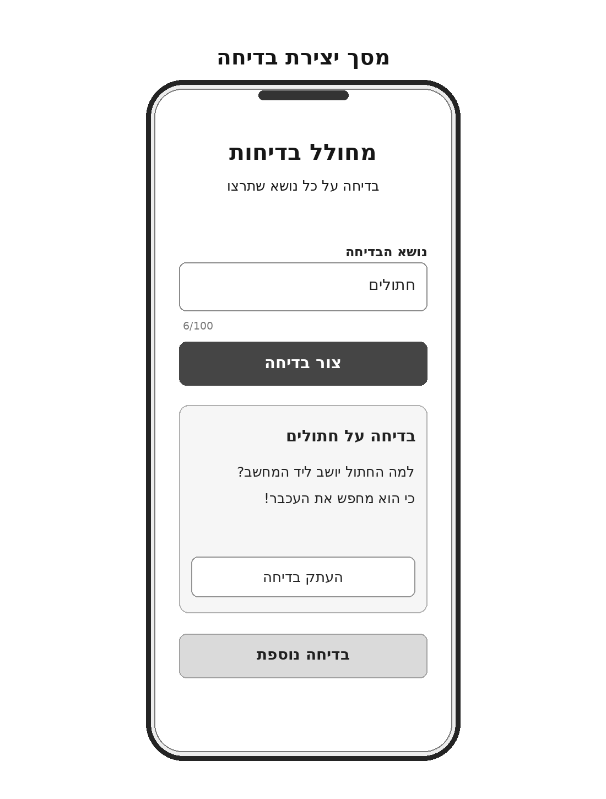
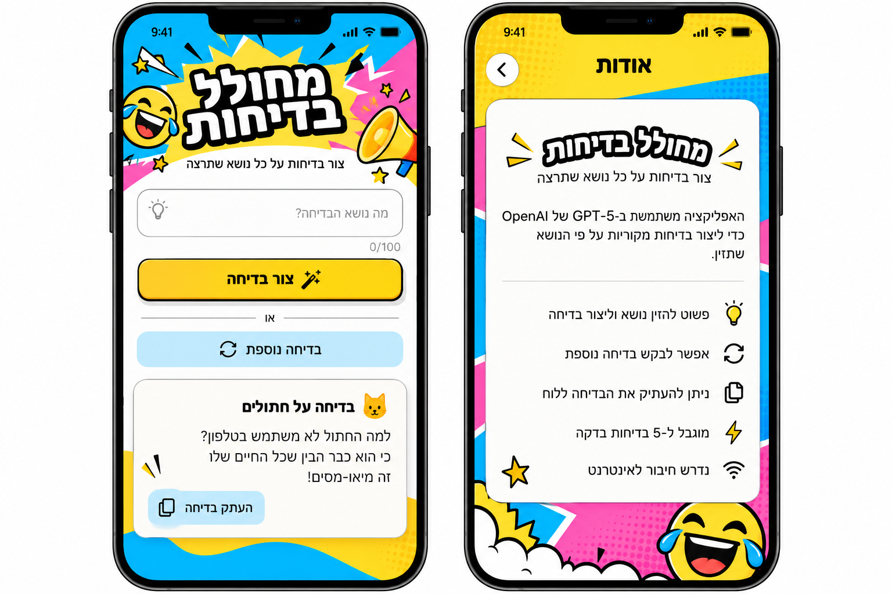
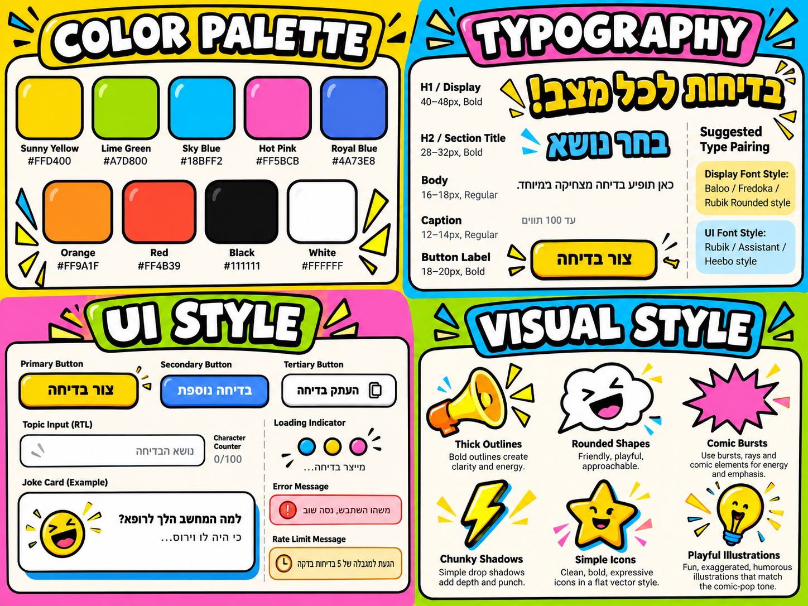

# DESIGN — מחולל בדיחות מבוסס AI

המסמך מתאר את המימוש החזותי בהתאם ל־`PRD.md`, ל־Wireframes, ל־Style Guide ול־Mockups. הדרישות הפונקציונליות נשארות ב־PRD.

> **אי־התאמה במקורות:** ה־PRD ותמונת ה־Wireframes מגדירים מסך אחד בלבד. תמונת ה־Mockups כוללת גם מסך "אודות", שלא הוגדר במוצר. אין לממש מסך זה; ה־Mockups משמשים להמחשת הסגנון בלבד. סדר הרכיבים נקבע לפי ה־Wireframes, גם כאשר הוא שונה ב־Mockups.

## 1. Screens – מסכי האפליקציה

### מסך יצירת בדיחה

**מטרה:** לאפשר הזנת נושא, הצגת בדיחה, יצירת בדיחה נוספת והעתקת בדיחה — הכול באותו מסך.

**מבנה ותוכן (מלמעלה למטה):**

1. **Header:** הכותרת "מחולל בדיחות" ותיאור קצר "בדיחה על כל נושא שתרצו". הכותרת גדולה, נועזת ובהשראת Comic.
2. **Topic Input:** תווית "נושא הבדיחה", שדה קלט יחיד המיושר לימין ומונה תווים עד `100`. ב־Wireframe הנושא לדוגמה הוא "חתולים"; ב־Mockup מופיע Placeholder "מה נושא הבדיחה?".
3. **Primary Action:** כפתור רחב "צור בדיחה" מיד מתחת לקלט.
4. **Joke Card:** כרטיס בדיחה מתחת לכפתור, ובו כותרת נושא (לדוגמה "בדיחה על חתולים"), גוף הבדיחה וכפתור "העתק בדיחה".
5. **Secondary Action:** כפתור "בדיחה נוספת" מתחת לכרטיס. מיקום זה מוכתב על ידי ה־Wireframe, גם אם ב־Mockup הכפתור מופיע מעל הכרטיס.

**פעולות וניווט:** המשתמש יוצר בדיחה, מבקש בדיחה נוספת או מעתיק אותה ללא מעבר למסך אחר. טעינה, שגיאה ובדיחה מוצגת הם מצבים של אותו מסך, ולא מסכים חדשים. בעת עריכת הנושא הבדיחה הנוכחית נשארת על המסך עד ליצירת בדיחה חדשה. במקרה של טקסט בדיחה ארוך, העמוד יכול להיגלל.

**ניווט כללי:** אין תפריט, Tabs או מסך "אודות". זהו מסך מוצר יחיד, גם כשהאתר נפתח כ־PWA.

### מצבי המסך

ה־Wireframe מציג רק את מצב "בדיחה מוצגת". שאר המצבים מוגדרים כאן. אזור ההודעות (טעינה או שגיאה) נמצא תמיד **מתחת לכפתור "צור בדיחה" ומעל כרטיס הבדיחה**.

| מצב | מה רואים |
| --- | --- |
| ריק (לפני בדיחה ראשונה, ואחרי רענון) | Header, שדה הנושא ו"צור בדיחה" בלבד. כרטיס הבדיחה ו"בדיחה נוספת" **מוסתרים**. |
| טוען | חיווי טעינה באזור ההודעות (שלוש נקודות צבעוניות + "מייצר בדיחה..."). "צור בדיחה" ו"בדיחה נוספת" מושבתים. כרטיס קיים נשאר כפי שהוא. |
| בדיחה מוצגת | כמו ב־Wireframe: כרטיס עם כותרת, גוף הבדיחה ו"העתק בדיחה", ומתחתיו "בדיחה נוספת". |
| שגיאה | תיבת שגיאה אדומה באזור ההודעות (או תיבת מגבלה כתומה ל־429, כמו ב־Style Guide). כרטיס קיים נשאר. ההודעה נעלמת בבקשה הבאה. |

**כותרת כרטיס הבדיחה:** לפי הנושא ששימש ליצירת הבדיחה המוצגת (לא לפי מה שכתוב כרגע בשדה).
- עם נושא: "בדיחה על {נושא}". נושא ארוך מ־40 תווים מקוצר עם "…".
- בלי נושא: "בדיחה כללית".
- נושא באנגלית מוצג בתוך הכותרת בכיווניות משלו (`<bdi>`), כך ש"בדיחה על cats" נקרא נכון.

### נוסחי הממשק

זו הרשימה המחייבת של כל הטקסטים בממשק. הפנייה למשתמש היא בלשון רבים ("נסו"), כמו בתת־הכותרת. שמות הכפתורים קבועים לפי ה־PRD.

| מקום | נוסח |
| --- | --- |
| כותרת | מחולל בדיחות |
| תת־כותרת | בדיחה על כל נושא שתרצו |
| תווית השדה | נושא הבדיחה |
| Placeholder | מה נושא הבדיחה? |
| כפתור ראשי | צור בדיחה |
| טעינה | מייצר בדיחה... |
| כותרת כרטיס | בדיחה על {נושא} / בדיחה כללית |
| כפתור משני | בדיחה נוספת |
| כפתור העתקה | העתק בדיחה |
| העתקה הצליחה (כשתי שניות, על הכפתור) | הועתק! |
| העתקה נכשלה | לא הצלחנו להעתיק. אפשר לסמן את הטקסט ולהעתיק ידנית. |
| שגיאה כללית (502, 503, תשובה לא צפויה) | משהו השתבש. נסו שוב בעוד רגע. |
| זמן המתנה חרג (504, או תקרת הזמן בדפדפן) | זה לקח יותר מדי זמן. נסו שוב. |
| אין חיבור לאינטרנט | אין חיבור לאינטרנט. בדקו את החיבור ונסו שוב. |
| מגבלת שימוש (429) | הגעתם למגבלה של 5 בדיחות בדקה. נסו שוב בעוד דקה. |
| סירוב תוכן (422) | על הנושא הזה לא נצליח להצחיק. נסו נושא אחר. |
| קלט לא תקין (400) | הנושא לא תקין. נסו לנסח אותו אחרת. |

### Wireframes

### Mockups

## 2. Style Guide – השפה העיצובית

### Style Guide חזותי

### Color Palette

שפת Comic / Pop Art צבעונית עם משטחים בהירים, הדגשות רוויות ומתארים שחורים. להלן צבעי ה־Style Guide והקודים המופיעים בו:

| צבע | HEX | ייעוד |
| --- | --- | --- |
| Sunny Yellow | `#FFD400` | כפתור ראשי, הדגשות וכותרות |
| Lime Green | `#A7D800` | הדגשות גרפיות |
| Sky Blue | `#18BFF2` | רקעים והדגשות |
| Hot Pink | `#FF5BCB` | רקעים ואפקטי Comic |
| Royal Blue | `#4A73E8` | פעולות משניות והדגשות |
| Orange | `#FF9A1F` | איורים והדגשות |
| Red | `#FF4B39` | הדגשות, לרבות מצבי שגיאה אם יש ניגודיות מספקת |
| Black | `#111111` | טקסט ומתארים |
| White | `#FFFFFF` | כרטיסי תוכן, שדות ומשטחי קריאה |

אין חובה להשתמש בכל הצבעים במסך. בתמונה המעוצבת בולטים במיוחד צהוב, כחול וורוד. הטקסט העיקרי נשאר כהה על רקע בהיר.

### Typography

| היררכיה | גודל | משקל | דוגמה |
| --- | --- | --- | --- |
| H1 / Display | `40–48px` | Bold | "מחולל בדיחות" |
| H2 / Section Title | `28–32px` | Bold | כותרות משנה וכרטיס |
| Body | `16–18px` | Regular | טקסט הבדיחה |
| Button Label | `18–20px` | Bold | "צור בדיחה" |
| Caption | `12–14px` | Regular | מונה תווים |

- **Display Font:** **Fredoka** (Bold), לכותרת הראשית ולכותרת הכרטיס. נבחר מתוך ההצעות ב־Style Guide משום שהוא מעוגל, חינמי ב־Google Fonts ותומך בעברית.
- **UI Font:** **Rubik**, לכל שאר הטקסטים: שדות, כפתורים וגוף הבדיחה.
- שני הגופנים נטענים דרך `next/font/google` עם subsets `hebrew` ו־`latin`, ולא רק נכתבים ב־CSS.
- **טיפול גרפי בטקסט:** לכותרת הראשית אפשר להוסיף מתאר שחור או Shadow בסגנון Comic; בגוף הבדיחה יש להימנע מאפקטים המפריעים לקריאה.

### UI Style

- **Primary Button:** "צור בדיחה" — צהוב בוהק, כיתוב שחור מודגש, פינות מעוגלות מאוד, Stroke כהה וצל קצר וברור; כפתור רחב ברוחב אזור התוכן.
- **Secondary Button:** "בדיחה נוספת" — צבע כחול או בהיר, מסגרת ברורה, פינות מעוגלות; נשאר מתחת לכרטיס הבדיחה.
- **Copy Button:** "העתק בדיחה" — פעולה שלישונית קטנה יותר, בתוך כרטיס התוצאה, עם אייקון Clipboard. אחרי העתקה מוצלחת הכיתוב מתחלף ל"הועתק!" עם סימן ✓ לכשתי שניות.
- **Input:** שדה לבן מעוגל עם מסגרת כהה/אפורה, תווית מעליו, יישור RTL ומונה תווים קטן.
- **Joke Card:** משטח לבן או כמעט לבן, פינות מעוגלות, Stroke ברור ו־Chunky Shadow קצר; הכותרת והבדיחה הן מוקד הקריאה. קישוט קומיקסי קטן יכול להיות חזותי בלבד.
- **Loading / Error:** חיווי טעינה והודעת שגיאה מוצגים בתוך המסך הקיים; ב־Style Guide מופיעים דוגמת חיווי צבעוני ותיבת שגיאה מובחנת. הטקסטים המדויקים נקבעים לפי ההקשר וה־PRD.
- **Menus / Navigation:** אין רכיבי ניווט, Tabs או תפריטים במוצר. דוגמאות גנריות ב־Style Guide אינן פיצ'רים למימוש.

### Visual Style

- **אווירה:** משעשעת, צעירה ואנרגטית; Comic / Pop Art עם היררכיה ברורה של אזורי תוכן.
- **צורות:** צורות מעוגלות, כוכבים, קרני הדגשה, בועות דיבור והתפרצויות קומיקס, כעיטור בלבד.
- **קווי מתאר וצללים:** Stroke שחור עבה לאיורים ולכותרות; מסגרות מעודנות יותר לטקסטים צפופים. צללים קצרים ומובהקים ולא טשטוש כבד.
- **Spacing:** מרווחים נדיבים ועקביים בין הכותרת, הקלט, הכפתור הראשי, הכרטיס והכפתור המשני. במקורות לא הוגדרו ערכי Spacing מספריים מחייבים.
- **Layout:** עמודת תוכן אחת ב־Mobile, עם שוליים אופקיים עקביים ו־Viewport בגובה מסך Smartphone; תוכן ארוך גולל את העמוד ולא מאריך את מסגרת המסך העיצובית.
- **Iconography / Illustration:** איורי וקטור שטוחים, עבים ומלאי הבעה; אייקונים ברורים כגון Clipboard. אין צורך בתמונות מצולמות. העיטורים לא אמורים להסתיר את הכרטיס או להפוך ללחצנים חדשים.
- **מקור האיורים:** אין קבצי איורים מוכנים. העיטורים (כוכבים, קרני הדגשה, התפרצות קומיקס ופרצוף צוחק פשוט) מצוירים כ־SVG פשוט בתוך הקוד, ברוח ה־Mockup אך בפשטות רבה יותר. אין להוריד איורים או אייקונים מאתרים חיצוניים. אם יסופקו בהמשך קבצי איורים, הם יוחלפו בתיקייה `public/`.

### PWA — שם, צבע ואייקון

| שדה | ערך |
| --- | --- |
| `name` | מחולל בדיחות |
| `short_name` | בדיחות |
| `theme_color` | `#FFD400` |
| `background_color` | `#FFFFFF` |
| אייקון | ריבוע צהוב `#FFD400` עם פרצוף צוחק פשוט בקו שחור, שנוצר בקוד (`ImageResponse` של Next.js) בגדלים 192, 512 ו־180 (אייפון) |

### שפה וכיווניות

- כל טקסט ממשק בעברית; פריסת `RTL` ויישור לימין של תוויות, קלט וגוף טקסט בעברית.
- כותרת המוצר יכולה להיות ממורכזת כפי שמופיע בתמונות; אין בכך שינוי בכיווניות המסך.
- אם הבדיחה עצמה באנגלית, יש להגדיר כיווניות `LTR` למקטע התוכן האנגלי, תוך השארת פקדי הממשק בעברית ו־RTL.
- מונה תווים כגון `6/100` צריך להופיע בסדר מספרי קריא בתוך הממשק הימני.

**סדר קדימויות למימוש:** לפי הכללים ב־`CLAUDE.md` (סעיף "טיפול בסתירות בין מקורות"). אין לממש מסכים או פיצ'רים המופיעים רק באיורים.
